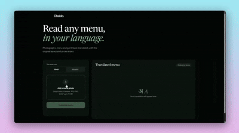

# Chaklo

Chaklo extracts text from a menu photo, translates it into Hindi or Marathi,
and renders the translated menu while preserving prices and approximate layout.
It can also show optional Spoonacular dish-name nutrition estimates.

## Assets




[Watch the Chaklo demo video](assets/chaklo-demo.mp4)

## Setup

This project requires Python 3.11 or newer and [uv](https://docs.astral.sh/uv/).

```powershell
cd C:\ProjectFiles\hacktoberfest
uv sync
Copy-Item .env.example .env
```

Open `.env` and set `SPOONACULAR_API_KEY` to your own Spoonacular API key.
The backend loads this `.env` file during import/startup; the key is read only
by the backend and must not be placed in frontend files.
If it is omitted, translation still works and nutrition is reported as
unavailable.

## Run

```powershell
cd C:\ProjectFiles\hacktoberfest
uv run uvicorn backend.main:app --reload
```

Open <http://127.0.0.1:8000>.

For a temporary PowerShell-only configuration instead of `.env`:

```powershell
$env:SPOONACULAR_API_KEY = "your-spoonacular-key"
uv run uvicorn backend.main:app --reload
```

## API

### `POST /api/translate`

Multipart form fields:

- `file`: JPEG, PNG, or WebP menu image, up to 15 MB
- `language`: `hin_Deva` or `mar_Deva`

The response includes the translated image and extracted items. Nutrition is
requested separately only after the user selects a dish using
`POST /api/nutrition` with JSON `{"dish_name": "..."}`. Nutrition uses
Spoonacular's documented `GET /recipes/guessNutrition` endpoint with the OCR
dish name passed as `title`.

Nutrition statuses include:

- `estimated`: complete dish-name estimate with calories, protein,
  carbohydrates, fat, serving assumption, source, and estimate type
- `unavailable`: no key, no complete match, timeout, malformed response, or
  other API failure
- `rate_limited`: Spoonacular returned HTTP 402 (quota) or 429 (rate limit)

## Tests

```powershell
cd C:\ProjectFiles\hacktoberfest
uv run pytest
```

The nutrition tests use mocked HTTP responses and do not send requests to
Spoonacular.

## Limitations

- Nutrition is an approximate dish-name estimate, not a laboratory
  measurement and not the exact nutritional content of a restaurant serving.
- Spoonacular may not recognize OCR text, especially for regional dishes,
  spelling variations, or noisy photos.
- The current feature does not match a restaurant recipe or verify ingredients.
  The allergen-awareness panel therefore never labels a dish safe or
  allergen-free; absence of a listed allergen is not evidence of absence or
  absence of cross-contact.
- Spoonacular quotas, rate limits, network failures, and missing API keys make
  nutrition unavailable without interrupting translation.
- Results are cached in memory per normalized dish name for a short period and
  are lost when the backend restarts.